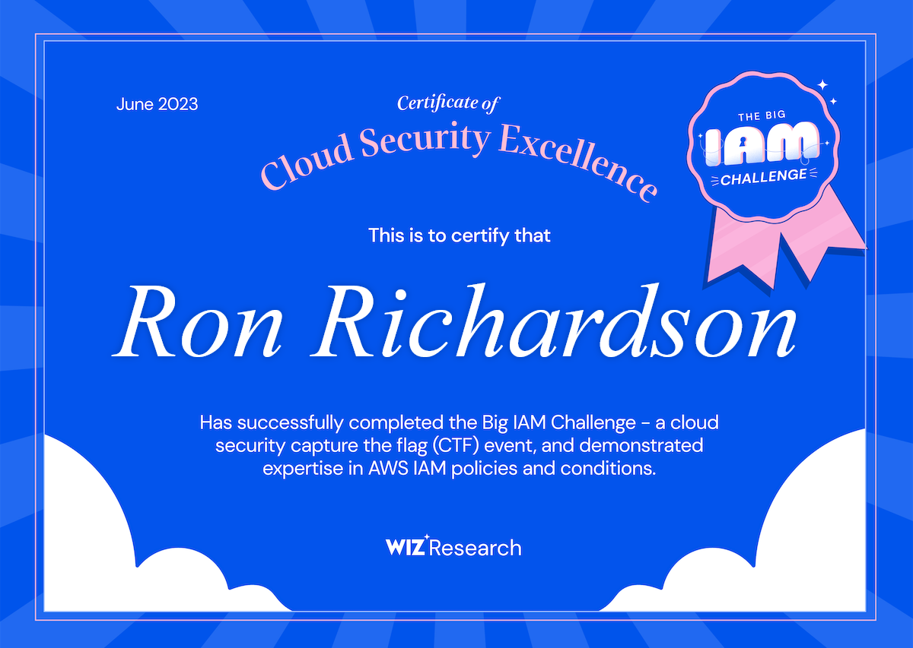

# Big IAM Challenge Lab

[Portfolio index](https://github.com/IAM-ZeroTrustRon/GRC-IAM-Portfolio) · **Repository role:** Authorized AWS security challenge.

**Ronald Richardson | Wiz Research CTF | Lab work documented October 14, 2026**

I investigated how cloud permissions can expose data even when a policy appears restricted. Across six challenges, I reviewed resource policies, tested access with different identities, and traced guest access into a role intended for authenticated users. I then translated those observations into business risks and proposed control improvements.

## Outcome

Six challenges completed, supported by the supplied completion certificate and staged progress evidence. The public evidence includes the 50-point screen for challenges 1–5 and the final role-access results. A final 60-point scoreboard screenshot is not included. Challenge 4's detailed technical handoff remains pending; its completion is corroborated by the progress screen.

The certificate prints June 2023; the documented working session was October 14, 2026. This is a CTF completion artifact, not an AWS certification.

## What this demonstrates

| Area | Practical result |
|---|---|
| S3 resource policies | Demonstrated unsigned listing and retrieval in the challenge bucket |
| SQS permissions | Distinguished denied anonymous access from successful signed message retrieval |
| SNS conditions | Used an allowed textual suffix in a webhook URL, then confirmed notification delivery |
| Condition semantics | Reviewed an admin-restriction policy using ForAllValues; completion verified, detailed test handoff pending |
| Cognito guest permissions | Obtained guest credentials and tested their S3 access |
| Federated trust | Assumed the target authenticated-named role using a guest identity token and verified its separate resource access |

## Lab documentation

- [Executive risk brief](docs/executive-risk-brief.md): what the results mean for management and decisions to make.
- [Findings and lessons](docs/findings-and-lessons.md): six distinct technical observations, with evidence boundaries.
- [Risk treatment plan](docs/risk-treatment-plan.md): proposed owners, controls and acceptance tests.
- [Evidence register](docs/evidence-register.md): selected screenshots and limitations, with no repeated gallery.

## Scope and responsible interpretation

The work was conducted in the authorized [Wiz Big IAM Challenge](https://bigiamchallenge.com/) environment with interactive AI mentoring. No production system or patient information was assessed. Healthcare implications are hypothetical business examples. No remediation was applied to Wiz infrastructure, no residual-risk reduction is claimed, and passing the CTF does not establish legal compliance.

These policies are intentionally vulnerable training configurations. A public resource or guest identity can be legitimate; the concern is whether its effective permissions match the intended data classification and access need. Temporary credentials and answer flags are not published.

## Related project

The [AWS Cloud Quest Core Security Concepts lab](https://github.com/IAM-ZeroTrustRon/IAM-AWS_CloudQuest-LAB) demonstrates the configuration side: support-group permissions and denied modification. This case study demonstrates how to test and explain misconfigurations. Both are separate entries in my [GRC and IAM portfolio](https://github.com/IAM-ZeroTrustRon/GRC-IAM-Portfolio).
